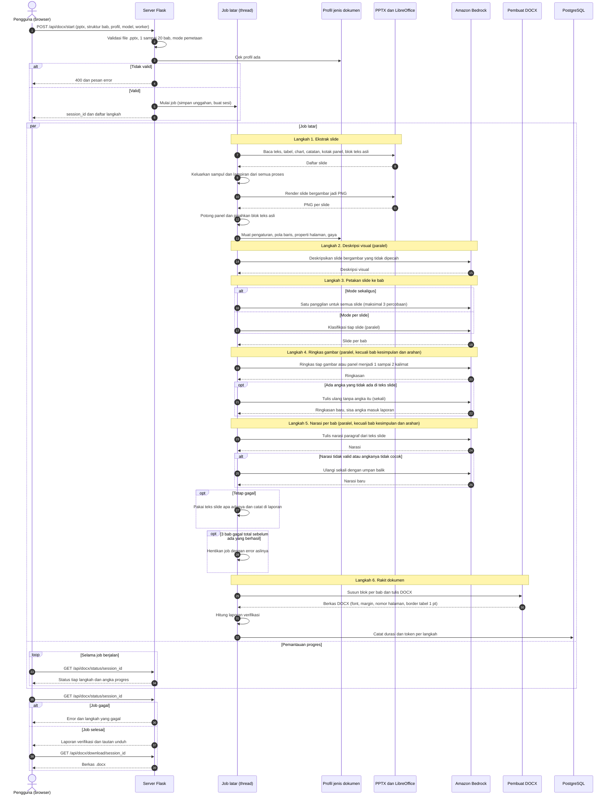

# PPT ke Dokumen

Aplikasi web Flask untuk mengekstrak konten PowerPoint, menyusunnya menjadi dokumen HTML per bab melalui Amazon Bedrock Converse API, dan mengedit hasilnya di CKEditor.

## Persiapan

Gunakan Python 3.10 atau lebih baru. Siapkan AWS credentials melalui AWS profile, environment, atau IAM role dan pastikan akun dapat memanggil model Amazon Bedrock yang dipilih.

```bash
python -m venv .venv
source .venv/bin/activate
pip install -r requirements.txt
```

Untuk mendeskripsikan gambar dan grafik dari slide secara visual, pasang LibreOffice serta Poppler (`soffice` dan `pdftoppm`) pada mesin yang menjalankan aplikasi. Tanpa keduanya, teks, tabel, notes, dan data chart tetap diekstrak, tetapi tidak ada deskripsi visual untuk slide.

## Jalankan

### Menggunakan API key Amazon Bedrock

Tidak perlu membuat AWS profile untuk API key Bedrock. Hentikan server lama
dengan Ctrl+C, lalu jalankan semua perintah berikut di terminal yang sama:

```bash
source .venv/bin/activate
unset AWS_PROFILE AWS_DEFAULT_PROFILE
export AWS_REGION=ap-southeast-2
printf 'Masukkan API key Bedrock: '
read -s AWS_BEARER_TOKEN_BEDROCK
export AWS_BEARER_TOKEN_BEDROCK
printf '\n'
HOST=127.0.0.1 PORT=5003 MAX_UPLOAD_MB=1000 python3 app.py
```

API key dimasukkan tanpa ditampilkan. Jangan simpan key di kode atau dokumentasi.
Buka `http://127.0.0.1:5003` dan isi ID model yang tersedia untuk akun dan region
AWS Anda di formulir.

Di macOS, port 5000 dapat digunakan AirPlay Receiver (AirTunes) dan menampilkan
`403 Forbidden` atau `Access denied`. Gunakan port 5003 untuk aplikasi ini.

Error `The config profile (...) could not be found` berarti server masih memakai
nama profil yang tidak terdaftar. Mengubah environment di terminal lain tidak
mengubah environment server yang sudah berjalan: hentikan dan jalankan ulang
server setelah `unset AWS_PROFILE AWS_DEFAULT_PROFILE`.

### Menggunakan login browser AWS

Dependensi `botocore[crt]` dalam `requirements.txt` diperlukan agar boto3 dapat
membaca kredensial dari `aws login`. Setelah memperbarui dependensi, jalankan:

```bash
.venv/bin/python -m pip install -r requirements.txt
aws login --profile bedrock-login --region us-east-1
unset AWS_BEARER_TOKEN_BEDROCK AWS_ACCESS_KEY_ID AWS_SECRET_ACCESS_KEY AWS_SESSION_TOKEN AWS_DEFAULT_PROFILE
export AWS_PROFILE=bedrock-login
export AWS_REGION=us-east-1
HOST=127.0.0.1 PORT=5003 MAX_UPLOAD_MB=1000 .venv/bin/python app.py
```

Hentikan server lama sebelum menjalankannya ulang agar dependensi dan environment
baru digunakan.

### Menggunakan IAM credentials atau SSO

Gunakan alternatif ini jika sudah memiliki AWS CLI profile yang dikonfigurasi
dengan IAM credentials atau SSO, bukan hanya nama API key Bedrock:

```bash
unset AWS_BEARER_TOKEN_BEDROCK
export AWS_PROFILE=nama-profile-yang-sudah-dikonfigurasi
export AWS_REGION=us-east-1
HOST=127.0.0.1 PORT=5003 MAX_UPLOAD_MB=1000 .venv/bin/python app.py
```

Lihat nama profil yang tersedia dengan `aws configure list-profiles`.

## Alur

1. Unggah PPTX utama dan tentukan judul bab, satu per baris.
2. Opsional, unggah hingga dua pasangan PPTX dan dokumen final UTF-8 (`.html` atau `.txt`) untuk contoh gaya.
   Jika materi contoh lebih banyak, isi Knowledge Base ID agar tiga potongan paling relevan diambil melalui Bedrock Knowledge Bases.
3. Aplikasi mengekstrak teks, tabel, speaker notes, dan data chart. Jika LibreOffice dan Poppler tersedia, slide visual dirender untuk dideskripsikan lewat model multimodal.
4. Bedrock memetakan slide ke bab, lalu membuat HTML per bab.
5. Tinjau/edit hasil di CKEditor; unduh dokumen HTML ketika siap.

Dokumen final referensi dikirim ke model sebagai contoh gaya, jadi jangan unggah dokumen yang berisi informasi rahasia. File unggahan sementara dihapus setelah pemrosesan.

## PPT ke DOCX

Menu **PPT → DOCX** membuat dokumen Word dari PPT dengan format, gaya, dan susunan gambar yang meniru dokumen referensi. Fakta hanya berasal dari PPT; format dan gaya berasal dari *profil* jenis dokumen.

### Alur kerja (sequence diagram)

Diagram ini menunjukkan urutan interaksi sejak PPT diunggah sampai DOCX diunduh. Blok `par` berarti dikerjakan bersamaan: job berjalan di thread latar sementara halaman memantau progresnya, dan panggilan ke Bedrock dikerjakan beberapa worker sekaligus (jumlahnya dipilih di form).



Aturan yang dipakai pada langkah penyusunan (6) untuk tiap slide:

| Kondisi slide | Hasil di dokumen |
|---|---|
| Sampul atau lampiran | Dibuang dari semua proses |
| Slide pembatas (teks pendek berupa label, tanpa judul, tabel, chart) | Dilewati dan dicatat di laporan |
| Berada di bab "kesimpulan" atau "arahan" | Seluruh teks slide apa adanya, tanpa narasi dan tanpa ringkasan gambar |
| Memuat blok "Hasil Pembahasan Dewan Gubernur" atau "Key Takeaways" | Blok itu apa adanya di atas gambar, sisa teks tetap dinarasikan |
| Perlu gambar (chart, diagram, tabel angka, gambar dengan teks pendek) | Tabel dua kolom gambar dan caption: satu baris per panel bila terdeteksi 2 panel atau lebih, atau satu baris untuk slide utuh; narasi paragraf di bawahnya |
| Tabel hanya berisi teks, atau slide padat teks | Ditulis sebagai teks (paragraf) tanpa gambar |

Bullet dan penomoran hanya muncul pada teks yang dibawa apa adanya dari slide; narasi yang ditulis model selalu paragraf.

### Profil jenis dokumen dan pengaturan

Bangun profil sekali per jenis dokumen dari HTML referensi (hasil CKEditor) dan, bila ada, PDF-nya:

```bash
.venv/bin/python profile_builder.py referensi/*.html --pdf referensi/*.pdf --name dokumen-2d --title "Dokumen 2d"
```

Profil tersimpan di `profiles/<nama>/` (layout tabel dan gambar, jenis caption, properti halaman dari PDF, statistik gaya penulisan). Pengaturan yang bisa diubah di menu (aturan penomoran caption, caption bawaan) disimpan di `settings.json` dan tidak terhapus saat profil dibangun ulang. Panduan gaya dari model (`style_guide.json`) dibuat dari menu dan juga tidak terhapus.

Sampul (slide pertama bila hanya berisi teks pendek) dan lampiran (dari slide pembatas "LAMPIRAN ..." pertama sampai akhir dek) dikeluarkan dari semua proses dan dicatat di laporan hasil. Teks slide pada bab yang judulnya memuat "kesimpulan" atau "arahan" dibawa apa adanya ke dokumen, tanpa narasi dan tanpa ringkasan gambar. Blok teks di bawah label "Hasil Pembahasan Dewan Gubernur" dan "Key Takeaways" juga dibawa persis seperti di slide pada bab mana pun; sisa teks slide tetap dinarasikan.

Gambar slide ditempatkan dalam tabel dua kolom: gambar di kiri, caption di kanan. Caption berisi judul panel (teks persis dari slide, atau label bernomor bila aturan penomoran cocok) dan ringkasan 1–2 kalimat yang ditulis model dari gambar itu sendiri, tanpa fakta tambahan. Angka di ringkasan harus ada di teks slide; yang tidak ada diminta dibuang sekali, dan sisanya dilaporkan di hasil sebagai angka yang perlu diperiksa. Slide yang dipecah menjadi panel tidak lagi dideskripsikan utuh, cukup tiap panelnya.

Langkah yang memanggil model per slide atau per bab (deskripsi visual, pemetaan per slide, narasi bab) berjalan dengan beberapa worker paralel. Jumlahnya dipilih di form (1–8, bawaan 4) atau lewat `DOCX_WORKERS`; hasil tetap digabung sesuai urutan slide dan bab, dan token dihitung dengan benar. Pemetaan "sekaligus" tetap satu panggilan. Throttling Bedrock ditangani klien (mode retry adaptive); bila worker terlalu banyak membuat sering terkena throttling, turunkan jumlahnya.

Narasi yang ditulis model selalu berupa paragraf, tanpa bullet dan penomoran; bullet hanya muncul pada teks yang dibawa apa adanya dari slide (bab kesimpulan/arahan, "Hasil Pembahasan Dewan Gubernur", "Key Takeaways"). Semua tabel di DOCX memakai border solid 1 pt.

Pemakaian waktu dan token fitur lain juga dicatat ke `document_processing_log` dengan penanda di nama dokumen: `[KB Correction]`, `[Part Document: koreksi bagian]`, `<berkas> [Mapping manual]` (satu baris per sesi, saat finalisasi), dan `<profil> [Panduan gaya]`. Token koreksi KB masuk ke kolom `kb_*`; token penulisan, koreksi, dan panduan gaya ke `writing_*`.

Setiap pembuatan DOCX, berhasil atau gagal, mencatat durasi dan jumlah token per langkah ke tabel `document_processing_log` lewat fungsi yang sama dengan alur dokumen HTML. Nama dokumen diberi akhiran `[PPT→DOCX]` untuk membedakannya. Token narasi masuk ke kolom `writing_*`; langkah perakitan tidak punya kolom sendiri tetapi termasuk di `total_seconds`, dan kolom `kb_*` kosong. 

Cara kerja pembuatan DOCX:

- Slide bergambar, chart, diagram, dan tabel dirender menjadi gambar (butuh LibreOffice dan Poppler). Slide teks menjadi paragraf.
- Model hanya menulis narasi tiap slide. Layout, caption, dan nomor ditentukan kode dari profil.
- Angka di narasi diperiksa terhadap isi slide asalnya; yang tidak ditemukan dilaporkan di panel hasil. Pemeriksaan ini tidak menangkap tafsiran yang tidak tertulis di slide, jadi narasi tetap perlu ditinjau.
- Font dokumen mengikuti HTML referensi (Frutiger 45 Light, 11 pt); font itu harus terpasang di komputer pembuka. Watermark belum dipasang.
- Judul bab dicocokkan dengan kata kunci aturan penomoran. Kata kunci bawaan diambil dari judul bagian referensi dan biasanya terlalu panjang; persingkat di panel Penomoran caption.

## Konfigurasi

- `BEDROCK_MODEL_ID`: default `us.anthropic.claude-opus-4-5-20251101-v1:0`, inference profile US untuk Claude Opus 4.5. Model ini memerlukan inference profile, bukan ID foundation model langsung. Permintaan dapat diproses di `us-east-1`, `us-east-2`, atau `us-west-2`, mengikuti izin IAM dan SCP organisasi. Dapat diganti melalui environment atau formulir.
- `BEDROCK_KNOWLEDGE_BASE_ID`: ID Knowledge Base untuk retrieval contoh gaya, opsional; izin IAM `bedrock:Retrieve` diperlukan.
- `AWS_REGION` atau `AWS_DEFAULT_REGION`: region AWS; jika tidak diset, aplikasi menggunakan region dari AWS profile. Region juga dapat diisi pada formulir.
  Region diterapkan pada sesi AWS serta klien Bedrock agar pembaruan kredensial `aws login` juga memiliki region.
- `MAX_UPLOAD_MB`: batas ukuran request, default 100 MB.
- `UPLOAD_DIR`: direktori penyimpanan sementara, default `uploads/` di folder aplikasi.
- `HOST` dan `PORT`: alamat server, default `127.0.0.1:5003`.

Untuk penggunaan di jaringan produksi, jalankan melalui WSGI server dan tambahkan autentikasi, HTTPS, pembatasan akses, serta kebijakan retensi file sesuai kebutuhan organisasi.
