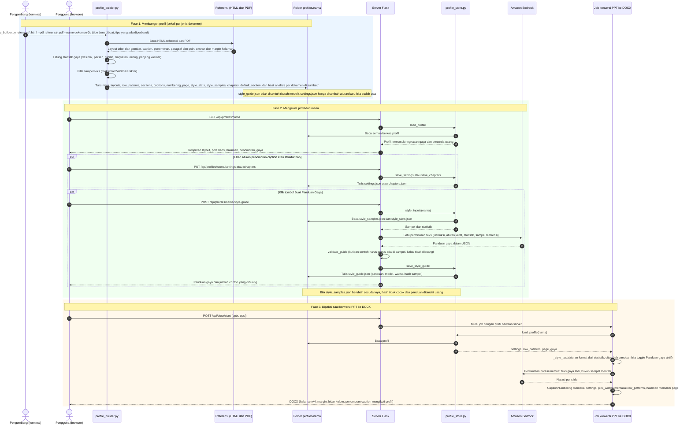

# PPT ke Dokumen

Aplikasi web Flask yang mengubah PowerPoint (.pptx) menjadi dokumen Word (.docx). Konten slide diekstrak, dipetakan ke bab dan ditulis menjadi narasi lewat Amazon Bedrock Converse API, lalu dirakit menjadi DOCX mengikuti format profil jenis dokumen.

## Persiapan

Gunakan Python 3.10 atau lebih baru. Siapkan AWS credentials melalui AWS profile, environment, atau IAM role dan pastikan akun dapat memanggil model Amazon Bedrock yang dipilih.

```bash
python -m venv .venv
source .venv/bin/activate
pip install -r requirements.txt
```

Untuk mendeskripsikan gambar dan grafik dari slide secara visual, pasang LibreOffice (`soffice`) pada mesin yang menjalankan aplikasi. Tanpa LibreOffice dan PyMuPDF, teks, tabel, dan data chart (hanya yang berada di dalam kanvas slide; speaker notes tidak diambil) tetap diekstrak, tetapi tidak ada deskripsi visual untuk slide.

## Jalankan

### Menggunakan API key Amazon Bedrock

Tidak perlu membuat AWS profile untuk API key Bedrock. Hentikan server lama
dengan Ctrl+C, lalu jalankan semua perintah berikut di terminal yang sama:

```bash
source .venv/bin/activate
unset AWS_PROFILE AWS_DEFAULT_PROFILE
export AWS_REGION=ap-southeast-2
printf 'Masukkan API key Bedrock: '
read -s AWS_BEARER_TOKEN_BEDROCK
export AWS_BEARER_TOKEN_BEDROCK
printf '\n'
HOST=127.0.0.1 PORT=5003 MAX_UPLOAD_MB=1000 python3 app.py
```

API key dimasukkan tanpa ditampilkan. Jangan simpan key di kode atau dokumentasi.
Buka `http://127.0.0.1:5003` dan isi ID model yang tersedia untuk akun dan region
AWS Anda di formulir.

Di macOS, port 5000 dapat digunakan AirPlay Receiver (AirTunes) dan menampilkan
`403 Forbidden` atau `Access denied`. Gunakan port 5003 untuk aplikasi ini.

Error `The config profile (...) could not be found` berarti server masih memakai
nama profil yang tidak terdaftar. Mengubah environment di terminal lain tidak
mengubah environment server yang sudah berjalan: hentikan dan jalankan ulang
server setelah `unset AWS_PROFILE AWS_DEFAULT_PROFILE`.

### Menggunakan login browser AWS

Dependensi `botocore[crt]` dalam `requirements.txt` diperlukan agar boto3 dapat
membaca kredensial dari `aws login`. Setelah memperbarui dependensi, jalankan:

```bash
.venv/bin/python -m pip install -r requirements.txt
aws login --profile bedrock-login --region us-east-1
unset AWS_BEARER_TOKEN_BEDROCK AWS_ACCESS_KEY_ID AWS_SECRET_ACCESS_KEY AWS_SESSION_TOKEN AWS_DEFAULT_PROFILE
export AWS_PROFILE=bedrock-login
export AWS_REGION=us-east-1
HOST=127.0.0.1 PORT=5003 MAX_UPLOAD_MB=1000 .venv/bin/python app.py
```

Hentikan server lama sebelum menjalankannya ulang agar dependensi dan environment
baru digunakan.

### Menggunakan IAM credentials atau SSO

Gunakan alternatif ini jika sudah memiliki AWS CLI profile yang dikonfigurasi
dengan IAM credentials atau SSO, bukan hanya nama API key Bedrock:

```bash
unset AWS_BEARER_TOKEN_BEDROCK
export AWS_PROFILE=nama-profile-yang-sudah-dikonfigurasi
export AWS_REGION=us-east-1
HOST=127.0.0.1 PORT=5003 MAX_UPLOAD_MB=1000 .venv/bin/python app.py
```

Lihat nama profil yang tersedia dengan `aws configure list-profiles`.

## PPT ke DOCX

Aplikasi ini membuat dokumen Word dari PPT dengan format, gaya, dan susunan gambar yang meniru dokumen referensi. Fakta hanya berasal dari PPT; format dan gaya berasal dari *profil* jenis dokumen.

### Alur kerja (sequence diagram)

Diagram ini menunjukkan urutan interaksi sejak PPT diunggah sampai DOCX diunduh. Blok `par` berarti dikerjakan bersamaan: job berjalan di thread latar sementara halaman memantau progresnya, dan panggilan ke Bedrock dikerjakan beberapa worker sekaligus (jumlahnya dipilih di form).


Aturan yang dipakai pada langkah penyusunan (6) untuk tiap slide:

| Kondisi slide | Hasil di dokumen |
|---|---|
| Sampul, agenda atau outline, atau lampiran | Dibuang dari semua proses |
| Slide pembatas (teks pendek berupa label, tanpa judul, tabel, chart) | Dilewati dan dicatat di laporan |
| Berada di bab "kesimpulan" atau "arahan" | Seluruh teks slide apa adanya, tanpa narasi dan tanpa ringkasan gambar |
| Memuat blok "Hasil Pembahasan Dewan Gubernur" atau "Key Takeaways" | Blok itu apa adanya di atas gambar, sisa teks tetap dinarasikan |
| Perlu gambar (tabel apa pun, chart, diagram, gambar dengan teks pendek) | Tabel dua kolom gambar dan caption: satu baris per panel bila terdeteksi 2 panel atau lebih, atau satu baris untuk slide utuh; narasi paragraf di bawahnya. Gambar yang luasnya lebih dari 50% kanvas slide (untuk slide utuh: objek gambar, chart, atau tabel terbesar; untuk panel: kotak panelnya) dipasang selebar 100% halaman di luar tabel: gambar di atas, caption dan ringkasan di bawahnya |
| Slide padat teks tanpa tabel, chart, atau diagram (gambar hanya dekorasi) | Ditulis sebagai teks (paragraf) tanpa gambar |

Bullet dan penomoran hanya muncul pada teks yang dibawa apa adanya dari slide; narasi yang ditulis model selalu paragraf.

### API konversi PPTX ke DOCX

Semua fungsi konversi bisa dipakai tanpa antarmuka web. Kontrak lengkap (OpenAPI 3) ada di `GET /api/docx/openapi.json`. Untuk mencoba langsung dari browser, buka Swagger UI di `/api/docx/docs` (memuat aset dari cdnjs, jadi butuh akses internet di browser). Tidak ada autentikasi, jadi jalankan hanya di jaringan lokal yang tepercaya. Pembuatan berjalan di latar belakang dan bisa memakan beberapa menit, jadi alurnya unggah, pantau, lalu unduh.

| Endpoint | Fungsi |
|---|---|
| `GET /api/docx/options` | Nilai bawaan dan batas: profil, mode pemetaan, worker, model, batas unggah, daftar langkah |
| `POST /api/docx/start` | Unggah PPTX dan mulai konversi. Mengembalikan `session_id` |
| `GET /api/docx/status/<id>` | Status (`running`, `done`, `error`, `cancelled`), progres tiap langkah, dan hasil bila selesai |
| `GET /api/docx/report/<id>` | Laporan verifikasi dan token job yang selesai, tanpa unduhan |
| `GET /api/docx/download/<id>` | Berkas `.docx` |
| `POST /api/docx/cancel/<id>` | Minta job berhenti (berlaku di antara slide, bab, dan langkah) |
| `DELETE /api/docx/<id>` | Hapus sesi dan berkas hasil tanpa menunggu kedaluwarsa |

Parameter `POST /api/docx/start` (multipart): `presentation` (.pptx) wajib. Opsional: `profile` (bawaan profil server, lihat `DOCX_PROFILE`), `mapping_mode` (`batch` atau `per_slide`, hanya berlaku di mode daftar bab), `chapters` dan `struktur` (judul bab satu per baris, 1–20, dan nama struktur bab tersimpan di profil; hanya dipakai bila server diatur `DOCX_CHAPTERS_MODE=daftar`, lihat di bawah), `style_guide` (`ya` atau `tidak`, bawaan `ya`: pakai panduan gaya dari model bila profil punya `style_guide.json`; `tidak` hanya memakai aturan format dari statistik), `fact_review` (`aturan` bawaan, `model`, atau `tidak`: tinjauan fakta ringkasan gambar), `format_review` (`ya` bawaan atau `tidak`: tinjauan format butir dan penomoran, lihat "Tinjauan" di bawah), `model_id`, `region`. Bila `chapters` tidak dikirim, struktur bab diambil dari struktur bernama `struktur`, atau struktur bawaan profil, atau bawaan aplikasi. `chapters` yang dikirim tetapi kosong ditolak. Struktur bab tersimpan dikelola lewat `PUT /api/profiles/<nama>/chapters`.

Contoh:

```bash
B=http://127.0.0.1:5003

# 1. Mulai
ID=$(curl -s -F presentation=@materi.pptx -F profile=dokumen-2d $B/api/docx/start | jq -r .session_id)

# 2. Pantau sampai selesai
until [ "$(curl -s $B/api/docx/status/$ID | jq -r .status)" != running ]; do sleep 5; done

# 3. Ambil hasil dan laporan
curl -s $B/api/docx/status/$ID | jq '.status, .error'
curl -s $B/api/docx/report/$ID | jq .laporan
curl -s -o hasil.docx $B/api/docx/download/$ID

# 4. Bersihkan (opsional; sesi juga kedaluwarsa otomatis)
curl -s -X DELETE $B/api/docx/$ID
```

Kesalahan dikembalikan sebagai `{"error": "..."}` dengan kode 400 (permintaan tidak valid), 404 (profil atau sesi tidak ada), 409 (status tidak sesuai, mis. laporan sebelum selesai), atau 413 (berkas terlalu besar).

### Profil jenis dokumen dan pengaturan

Satu skrip, `profile_builder.py`, membuat dan memperbarui semua berkas profil. Perintahnya sama untuk tipe dokumen baru maupun yang sudah ada; skrip memeriksa sendiri apakah `profiles/<nama>/` sudah ada:

```bash
# Tipe dokumen baru (belum ada di profiles/): folder dibuat
.venv/bin/python profile_builder.py referensi/*.html --pdf referensi/*.pdf --name dokumen-2d --title "Dokumen 2d"

# Ada dokumen referensi baru: sebut dokumen baru saja, yang lama dipertahankan dari hasil analisis tersimpan
.venv/bin/python profile_builder.py "referensi/DKEM RDGB Juni 2026.html" --pdf "referensi/RDGB_Juni 2026.pdf" --name dokumen-2d

# Periksa dulu apa yang akan berubah, tanpa menulis apa pun
.venv/bin/python profile_builder.py "referensi/DKEM RDGB Juni 2026.html" --name dokumen-2d --cek
```

Opsi lain: `--hapus <berkas>` mengeluarkan dokumen dari profil, `--ganti` membangun ulang hanya dari dokumen yang disebut, `--paksa` merakit ulang walau tidak ada dokumen baru, `--panduan-gaya` membuat ulang `style_guide.json` lewat Bedrock (dengan `--model-id` dan `--region`), dan `--out` mengganti folder profil (bawaan `profiles`).

**Validasi tipe dokumen.** `--name` harus huruf kecil, angka, dan tanda hubung (`dokumen-2d`); nama lain ditolak dengan daftar tipe yang sudah ada. Tipe yang belum punya folder dibuat baru (`TIPE DOKUMEN BARU DIBUAT`), sedangkan yang sudah ada diperbarui (`TIPE DOKUMEN SUDAH ADA, DIPERBARUI`). Daftar tipe yang ada selalu dicetak di baris pertama.

**Cara pembaruan.** Hasil analisis tiap dokumen referensi disimpan di `profiles/<nama>/sumber/` (satu berkas per dokumen). Saat diperbarui, skrip membandingkan nama dan hash tiap dokumen yang disebut: yang sama persis dilewati, yang isinya berubah diganti, yang baru ditambah, dan dokumen yang tidak disebut dipertahankan dari hasil tersimpan (tidak perlu ada lagi di folder `referensi/`). Semua berkas profil lalu dirakit ulang dari kumpulan itu, jadi hasilnya sama dengan membangun dari semua dokumen sekaligus. Profil yang dibuat sebelum folder `sumber/` ada hanya butuh satu kali menyebut **semua** dokumen referensinya (HTML dan PDF) agar cache terbentuk; skrip menolak dan menyebut dokumen yang kurang bila ada yang terlewat, supaya tidak ada data yang hilang diam-diam.

#### Apa yang berubah ketika profil diperbarui

| Berkas | Perilaku saat pembaruan |
|---|---|
| `meta.json` | Diganti: daftar sumber (nama, hash, jumlah gambar), `diperbarui_pada`, dan `riwayat` (maksimal 20 entri berisi waktu, dokumen ditambah, diganti, dihapus). `created_at` dan judul lama dipertahankan. |
| `layouts.json`, `row_patterns.json`, `sections.json`, `captions.json`, `numbering.json` | Dirakit ulang dari semua dokumen: hitungan layout, lebar kolom, caption, dan bukti penomoran ikut menghitung dokumen baru. |
| `style_stats.json`, `style_samples.json` | Dirakit ulang dari semua dokumen. Bila sampel berubah, `style_guide.json` yang lama ditandai usang. |
| `page.json` | Dirakit ulang dari semua PDF tersimpan (ukuran kertas, margin, skala cetak). Dihapus bila tidak ada PDF yang tersisa. Tidak lagi tertinggal basi seperti sebelumnya. |
| `chapters.json` | Struktur bab per dokumen referensi (judul tingkat 1 dan 2), dinamai menurut periodenya ("Maret 2026"), ditambah atau diganti. Struktur lain yang dibuat lewat menu tetap ada; struktur bawaan tetap, atau periode terbaru bila belum ada. Maksimal 10 struktur: yang tertua dibuang bila terlampaui. |
| `default_section.json` | Diturunkan dari bab pertama dokumen referensi terbaru yang punya dua sub-bab atau lebih (nama kolom jadi `nama`, huruf kapital atau singkatannya jadi `cocok`, mis. "Sistem Pembayaran" menjadi "SP"). Berkas ini ditandai `dibuat_oleh` dan hanya ditimpa bila tanda itu ada; berkas tanpa tanda (disunting manual) dibiarkan dan dilaporkan. |
| `settings.json` | Tidak dibuat skrip: bila tidak ada, aturan penomoran diturunkan otomatis dari caption setiap profil dimuat, jadi selalu mengikuti dokumen terbaru. Bila sudah ada (disimpan dari menu), skrip hanya **menambah** aturan untuk awalan atau bagian baru; aturan yang sudah ada, termasuk yang Anda ubah, tidak diubah atau dihapus. |
| `style_guide.json` | Tidak diubah kecuali dengan `--panduan-gaya`. Pembuatannya memanggil model dan mengirim sampel referensi ke Bedrock, jadi tidak pernah berjalan otomatis. Bila sampel berubah, hasilnya dilaporkan "usang" (sama dengan penanda di menu). |
| `sumber/` | Hasil analisis per dokumen referensi diperbarui: dokumen baru ditambah, yang berubah diganti, yang dihapus dibuang. |

Skrip mencetak ringkasan setiap kali dijalankan: dokumen yang ditambah, diganti, dihapus, dan tidak berubah; jumlah layout, caption, dan blok sampel sebelum dan sesudah; awalan penomoran yang muncul atau hilang; apakah sampel dan statistik gaya berubah; status tiap berkas turunan; dan status panduan gaya. Bila tidak ada dokumen baru atau berubah, tidak ada berkas yang ditulis.

Struktur bab disimpan di profil juga, di `profiles/<nama>/chapters.json`: satu atau beberapa struktur bernama (satu per periode referensi, diisi otomatis oleh `profile_builder.py`) dengan satu bawaan. Struktur tambahan bisa dibuat dan dikelola di panel **8. Struktur bab**. Struktur ini hanya dipakai bila server diatur `DOCX_CHAPTERS_MODE=daftar`; panel 2 tidak lagi memilih struktur bab. Profil tanpa struktur tersimpan memakai daftar bawaan aplikasi (`DOCX_DEFAULT_CHAPTERS` di `app.py`).

Profil tersimpan di `profiles/<nama>/` (layout tabel dan gambar, jenis caption, properti halaman dari PDF, statistik gaya penulisan). Pengaturan yang diubah di menu (aturan penomoran caption, caption bawaan) disimpan di `settings.json` dan dipertahankan saat profil diperbarui. Panduan gaya dari model (`style_guide.json`) dibuat dari menu atau dengan `--panduan-gaya`, dan juga dipertahankan.

#### Siklus profil: dibangun, dikelola, dipakai (sequence diagram)

Profil punya tiga fase yang berjalan di waktu berbeda. Tombol **Buat Panduan Gaya** ada di fase kedua: ia membaca berkas yang dihasilkan fase pertama, menulis `style_guide.json` ke profil yang sama, lalu hasilnya dipakai di fase ketiga.



Berkas profil dan siapa yang memakainya saat konversi:

| Berkas | Dibuat oleh | Dipakai saat konversi |
|---|---|---|
| `page.json` | `profile_builder.py` (dari PDF) | Ukuran kertas, margin, nomor halaman |
| `row_patterns.json` | `profile_builder.py` | Lebar kolom gambar dan caption |
| `settings.json` | menu (panel Penomoran caption) | Penomoran dan caption bawaan |
| `default_section.json` | `profile_builder.py` (diturunkan dari bab pertama referensi) | Memecah slide berkolom di section bawaan menjadi sub-bab (lihat "Pemetaan section bawaan") |
| `style_stats.json` | `profile_builder.py` | Aturan format angka dan istilah asing di prompt narasi (selalu) |
| `style_guide.json` | tombol Buat Panduan Gaya | Nada, larangan, dan contoh kutipan di prompt narasi (bila toggle aktif) |
| `chapters.json` | `profile_builder.py` (struktur per referensi), bisa ditambah lewat menu | Hanya bila `DOCX_CHAPTERS_MODE=daftar` |
| `style_samples.json` | `profile_builder.py` | Tidak dipakai konversi, hanya bahan tombol Buat Panduan Gaya |
| `captions.json`, `numbering.json` | `profile_builder.py` | Hanya untuk menurunkan aturan penomoran awal bila `settings.json` belum pernah disimpan |
| `layouts.json`, `sections.json`, `meta.json` | `profile_builder.py` | Ditampilkan di menu sebagai bukti, tidak dibaca oleh konversi |

#### Pemetaan section bawaan ("Default Section") lewat profil

Slide pembuka dek sering berada di section bawaan PowerPoint ("Default Section"), dan slide kesimpulannya bisa berupa satu slide berkolom: lencana judul di atas tiap kolom (misalnya MONETER, MAKROPRUDENSIAL, SP PUR) dengan satu kotak teks di bawahnya. Tanpa pengaturan, slide itu diproses apa adanya sebagai satu slide, dengan isi ketiga kolom bercampur menurut urutan shape. Dengan `profiles/<nama>/default_section.json` (dibuat otomatis oleh `profile_builder.py` dari bab pertama dokumen referensi terbaru, tidak perlu ditulis manual), slide itu dipecah per kolom seperti bab 1 pada dokumen referensi:

```json
{
  "bagian_cocok": "Default Section",
  "judul_bab": "1. Kesimpulan Diskusi Hari 1 dan Arahan ADG",
  "judul_kolom": "1.{n} Kesimpulan dan Arahan {nama}",
  "kolom": [
    {"cocok": "MONETER", "nama": "Moneter"},
    {"cocok": "MAKROPRUDENSIAL", "nama": "Makroprudensial"},
    {"cocok": "SP", "nama": "Sistem Pembayaran"}
  ]
}
```

- Deteksi kolom dilakukan saat ekstrak slide (`ppt_adapter.detect_columns`): minimal dua lencana huruf kapital pendek di pita atas yang tidak tumpang tindih, dan teks tiap kolom diambil menurut posisi horizontal kotak teks, bukan urutan shape. Slide dibiarkan utuh bila ada tabel, chart, gambar besar, kotak teks yang melintang antar kolom, atau kolom tanpa teks.
- `cocok` dibandingkan dengan teks lencana sebagai kata utuh tanpa membedakan huruf besar, jadi "SP PUR" cocok dengan "SP" (tetapi "SPESIAL" tidak). `nama` dan urutan `{n}` mengatur judul kolom; kolom diurutkan menurut daftar ini, bukan menurut letaknya di slide.
- Hasilnya satu slide semu per kolom, berjudul sesuai `judul_kolom`, dengan teks kolom dibawa apa adanya (label KESIMPULAN dan PROSPEK tebal, butir dan nomor sesuai slide) dan tanpa deskripsi visual dari model. Pada mode bab `slide`, section bawaan diberi nama `judul_bab` sehingga hasilnya judul 1 "1. Kesimpulan …" dengan judul 2 "1.1 …", "1.2 …", "1.3 …". Pada mode `daftar`, tiap slide semu dipasang langsung ke bab yang nomornya sama ("1.1 …") tanpa menunggu pemetaan model.
- Tanpa `default_section.json` (atau bila berkasnya rusak), tanpa section yang namanya cocok, atau bila ada lencana yang tidak cocok dengan daftar `kolom`, slide diproses apa adanya seperti sebelumnya. Slide yang dipecah dicatat di laporan sebagai `slide_dipecah_kolom`.

Sampul (slide pertama bila hanya berisi teks pendek), agenda atau outline pembahasan (judul atau baris pertama diawali "Agenda", "Outline", "Daftar isi", atau "Garis besar", tanpa tabel dan chart, maksimal 1.500 karakter, di slide mana pun), dan lampiran (dari slide pembatas "LAMPIRAN ..." pertama sampai akhir dek) dikeluarkan dari semua proses dan dicatat di laporan hasil. Teks slide pada bab yang judulnya memuat "kesimpulan" atau "arahan" dibawa apa adanya ke dokumen, tanpa narasi dan tanpa ringkasan gambar. Blok teks di bawah label "Hasil Pembahasan Dewan Gubernur" dan "Key Takeaways" juga dibawa persis seperti di slide pada bab mana pun; sisa teks slide tetap dinarasikan.

Gambar slide ditempatkan dalam tabel dua kolom: gambar di kiri, caption di kanan. Caption berisi judul panel (teks persis dari slide, atau label bernomor bila aturan penomoran cocok) dan ringkasan 1–2 kalimat yang ditulis model dari gambar itu sendiri, tanpa fakta tambahan. Angka di ringkasan harus ada di teks slide; yang tidak ada diminta dibuang sekali, dan sisanya dilaporkan di hasil sebagai angka yang perlu diperiksa. Slide yang dipecah menjadi panel tidak lagi dideskripsikan utuh, cukup tiap panelnya. Isi tabel, chart, dan teks di dalam kotak tiap panel (dari file PPTX) ikut dikirim bersama gambarnya sebagai acuan fakta. Teks berhuruf biasa di atas beberapa tabel atau gambar (mis. "Plan B : …") menjadi judul satu panel: objek di bawahnya satu gambar, teks judulnya tidak ikut gambar melainkan menjadi caption. Bila model tidak menghasilkan ringkasan, kolom caption diisi ringkasan deterministik dari tabel atau chart panel (judul, jumlah baris, nama baris, kolom); panel tanpa tabel atau chart yang gagal diringkas tetap kosong.

Langkah yang memanggil model per slide atau per bab (deskripsi visual, pemetaan per slide, narasi bab) berjalan dengan beberapa worker paralel. Jumlahnya diatur di server, bukan di UI atau parameter API: `DOCX_DEFAULT_WORKERS` di app.py (bawaan 8, maksimal 8) atau env `DOCX_WORKERS`; hasil tetap digabung sesuai urutan slide dan bab, dan token dihitung dengan benar. Pemetaan "sekaligus" tetap satu panggilan. Throttling Bedrock ditangani klien (mode retry adaptive); bila worker terlalu banyak membuat sering terkena throttling, turunkan jumlahnya.

Narasi yang ditulis model selalu berupa paragraf, tanpa bullet dan penomoran; bullet hanya muncul pada teks yang dibawa apa adanya dari slide (bab kesimpulan/arahan, "Hasil Pembahasan Dewan Gubernur", "Key Takeaways"). Semua tabel di DOCX memakai border solid 1 pt.

Teks slide yang bernomor otomatis di PowerPoint ("1.", "a.", "ii)", dsb.) tidak diparafrasekan model: dibawa apa adanya sebagai daftar bernomor di DOCX, dengan penanda yang sama dengan slide (urutan dihitung ulang per kotak teks, `startAt` dihormati) dan indentasi bersarang mengikuti margin paragraf di slide (nomor menggantung, teks sejajar). Nomor yang diketik manual di teks ("2.   Kebijakan ...") diperlakukan sama. Slide seperti ini dilaporkan di `slide_teks_asli`, dan teks aslinya tetap dipakai untuk pemetaan ke bab.

### Tinjauan (komentar Word)

Dua tinjauan, keduanya **tidak pernah mengubah teks**: temuan dipasang sebagai komentar Word pada paragraf atau butir yang bersangkutan dan dirangkum di laporan job.

**1. Tinjauan fakta ringkasan gambar** (`fact_review`, langkah `review`, sebelum perakitan). Hanya ringkasan gambar (caption slide atau panel) yang ditinjau, bukan narasi. Komentar bertanda `[Cek fakta: …]`, penulis "Peninjau Fakta", laporan di `laporan.tinjauan_fakta`.
- **`aturan`** (bawaan, tanpa token): `fact_review.py` membandingkan ringkasan dengan teks slide (beserta deskripsi visualnya): angka (pemisah desimal/ribuan disamakan, pembulatan wajar diterima, bilangan satu digit tanpa % diabaikan), periode (tahun, bulan, triwulan), dan arah perubahan ("naik dari 3,2% menjadi 2,8%"). Nama dan singkatan tidak diperiksa karena ringkasan gambar wajar menyebut nama yang hanya terbaca dari gambarnya.
- **`model`**: aturan ditambah satu permintaan per slide yang punya temuan aturan atau sedikitnya `FACT_REVIEW_MIN_NUMBERS` angka (bawaan 4; 0 = semua slide). Model menerima fakta slide dan gambar tiap ringkasan (gambar panel untuk slide yang dipecah) lalu hanya menandai klaim yang salah atau tidak didukung. Token dicatat di kolom `writing_*` tabel log. Slide yang gagal ditinjau dicatat di `gagal_model` tanpa menghentikan proses.
- **`tidak`**: langkah dilewati.

**2. Tinjauan format, urutan butir, dan penomoran** (`format_review` = `ya` bawaan atau `tidak`; `list_review.py`, berjalan di langkah perakitan, tanpa model dan tanpa token). Hanya untuk halaman yang memuat butir atau daftar bernomor yang dibawa apa adanya dari slide (bab kesimpulan/arahan, Hasil Pembahasan Dewan Gubernur, Key Takeaways). Komentar bertanda `[Cek format: …]`, penulis "Peninjau Format", laporan di `laporan.tinjauan_format`.
- **isi**: baris di dokumen sama dengan baris slide (urutan dan teks).
- **urutan**: nomor pada kedalaman yang sama berurutan (1, 2, 3 / a, b, c / i, ii, iii); nomor ganda, melompat, mundur, atau mulai lagi dari awal setelah disela butir tanpa nomor.
- **format**: gaya penanda berubah pada kedalaman yang sama ("3." lalu "a."), tingkat butir melompat lebih dari satu, atau kedalaman slide melebihi 3 tingkat sehingga diratakan.
- Tidak ditandai: penanda pertama yang bukan "1."/"a." (halaman lanjutan meneruskan daftar), daftar baru yang mulai dari "1." tanpa disela butir, dan daftar yang dimulai dari tingkat dalam.

Batas: pemeriksaan aturan fakta hanya melihat teks tertulis slide; angka yang hanya terbaca dari gambar ditandai "tidak ditemukan" dan perlu dicek manual, sedangkan kekeliruan tafsir hanya bisa ditangkap tinjauan model dan tidak sempurna. Tinjauan format hanya mendeteksi pola penomoran yang tidak lazim, bukan memastikan kesalahan: penomoran PowerPoint memang bisa mulai lagi setelah butir tanpa nomor, jadi temuan "mulai lagi" adalah ajakan mencocokkan dengan slide.

Pembuatan panduan gaya juga dicatat ke tabel log yang sama dengan penanda `<profil> [Panduan gaya]`; tokennya masuk ke kolom `writing_*`.

Setiap pembuatan DOCX, berhasil atau gagal, mencatat durasi dan jumlah token per langkah ke tabel `document_processing_log_v2` lewat `_log_processing_times`. Buat tabelnya sekali dengan `psql -d <database> -f db/schema.sql`; nama tabel bisa diganti lewat env `PROCESSING_LOG_TABLE`. Nama dokumen diberi akhiran `[PPT→DOCX]` untuk membedakannya. Kolomnya per langkah: `ingest_*`, `visuals_*` (deskripsi visual), `captions_*` (ringkasan gambar untuk caption), `mapping_*`, dan `writing_*` (narasi bab dan panduan gaya), masing-masing berisi `seconds`, `at`, `input_tokens`, `output_tokens`. Langkah perakitan tidak punya kolom sendiri tetapi termasuk di `total_seconds`. 

Cara kerja pembuatan DOCX:

- Slide bergambar, chart, diagram, dan tabel dirender menjadi gambar (butuh LibreOffice dan PyMuPDF). Slide teks menjadi paragraf.
- Model hanya menulis narasi tiap slide. Layout, caption, dan nomor ditentukan kode dari profil.
- Angka di narasi diperiksa terhadap isi slide asalnya; yang tidak ditemukan dilaporkan di panel hasil. Pemeriksaan ini tidak menangkap tafsiran yang tidak tertulis di slide, jadi narasi tetap perlu ditinjau.
- Font dokumen mengikuti HTML referensi (Frutiger 45 Light, 11 pt); font itu harus terpasang di komputer pembuka. Watermark belum dipasang.
- Judul bab dicocokkan dengan kata kunci aturan penomoran. Kata kunci bawaan diambil dari judul bagian referensi dan biasanya terlalu panjang; persingkat di panel Penomoran caption.

## Konfigurasi

- `DOCX_PROFILE`: profil jenis dokumen yang dipakai UI (tidak ada pilihan profil di UI) dan permintaan API tanpa `profile`. Bawaan `dokumen-2d`.
- `DOCX_CHAPTERS_MODE`: sumber struktur bab, diatur di server (tidak ada di UI maupun parameter API). `slide` (bawaan): tiap section PowerPoint menjadi satu bab tanpa pemetaan model; section yang namanya diawali "Lampiran" dilewati, nama section umum ("Default Section") diganti judul slide pertamanya, dan presentasi harus memakai section. `daftar`: daftar bab (`chapters`, struktur tersimpan profil, atau `DOCX_DEFAULT_CHAPTERS`) dipetakan model ke slide, dengan `mapping_mode` `batch` atau `per_slide`. Nilai lain ditolak dengan error 400.
- `BEDROCK_MODEL_ID`: default `us.anthropic.claude-opus-4-5-20251101-v1:0`, inference profile US untuk Claude Opus 4.5. Model ini memerlukan inference profile, bukan ID foundation model langsung. Permintaan dapat diproses di `us-east-1`, `us-east-2`, atau `us-west-2`, mengikuti izin IAM dan SCP organisasi. Dapat diganti melalui environment atau formulir.
- `AWS_REGION` atau `AWS_DEFAULT_REGION`: region AWS; jika tidak diset, aplikasi menggunakan region dari AWS profile. Region juga dapat diisi pada formulir.
  Region diterapkan pada sesi AWS serta klien Bedrock agar pembaruan kredensial `aws login` juga memiliki region.
- `CAPTION_FACTS_MAX_CHARS`: batas karakter teks slide yang dikirim bersama gambar untuk ringkasan caption, default 1500; `0` mengirim semuanya. Mengurangi token karena teks slide tidak terkirim penuh di setiap panel. Pemeriksaan angka tetap memakai teks lengkap.
- `MAPPING_TEXT_MAX_CHARS`: batas karakter teks per slide pada prompt pemetaan slide ke bab, default 2000; `0` tanpa batas. Prompt pemetaan hanya memuat judul, awal teks, judul chart, header tabel, dan potongan deskripsi visual; isi angka tabel dan chart tidak dikirim.
- `MAX_UPLOAD_MB`: batas ukuran request, default 100 MB.
- `UPLOAD_DIR`: direktori penyimpanan sementara, default `uploads/` di folder aplikasi.
- `HOST` dan `PORT`: alamat server, default `127.0.0.1:5003`.

Untuk penggunaan di jaringan produksi, jalankan melalui WSGI server dan tambahkan autentikasi, HTTPS, pembatasan akses, serta kebijakan retensi file sesuai kebutuhan organisasi.
